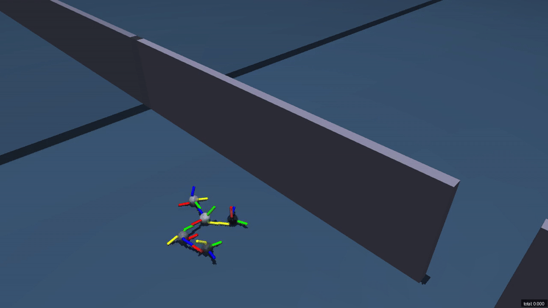

# Scenario catalog

SwarmBots has 17 registered tasks covering coordinated locomotion, physical reconfiguration, partial observability, and payload transport. Eight tasks form the core evaluation suite. Every task uses the same articulated modular units and actuator/connector interface, so policies must control both the units' movement and their connections.

| Wall traversal | Finding an opening |
| --- | --- |
|  |  |

These demonstrations illustrate behavior, not canonical evaluation results.

## Scenario maturity and versioning

SwarmBots as a whole is an **alpha benchmark**. Each registered scenario also has a maturity label describing how thoroughly its task design has been tested:

**All fixed-wall and PO-wall variants (easy, medium, and hard), plus FindOpening, are beta; every other registered scenario is alpha.**

| Maturity | Meaning |
| --- | --- |
| **Alpha** | Limited task-level testing. Difficulty may be too high or too low, reward functions may encourage unintended behavior, and success conditions or other task details may need revision. |
| **Beta** | Extensive internal testing, but no feedback from other researchers yet. Task design may still have gaps and is not considered final. |
| **Stable** | Reserved for a future stage after broader validation and independent research feedback. No scenario currently has this status. |

These labels assess testing confidence, not difficulty, policy performance, or core-suite membership. They apply to the registered defaults; custom variants need their own validation. The overall benchmark remains alpha even when individual scenarios are beta. Feedback channels are [GitHub issues](https://github.com/brn-dev/swarm-bots/issues) and email to Dominik Baron at [dominik.b4ron@gmail.com](mailto:dominik.b4ron@gmail.com); useful reports include the task ID, package version or Git commit, configuration, seed, and observed behavior.

Maturity and version identifiers serve different purposes:

- **Scenario maturity** (`alpha`, `beta`, or eventually `stable`) records the current testing assessment. It is available as `BenchmarkSpec.maturity`, in `swarmbots list` / `describe`, and as `metadata.benchmark_maturity` in evaluation reports.
- **Task version** (the `-v0` suffix in a benchmark ID) identifies the registered task definition. A maturity promotion alone does not change the ID. Changes to rewards, observations, success or termination conditions, morphology distributions, or physics that make scores incomparable should use a new task version.
- **Package version** (such as `0.1.0a3`) identifies the implementation release. Together with the Git commit, it identifies the implementation, including development checkouts; the maturity label and task ID alone do not.
- **Protocol version** (currently `0.1`) identifies the evaluation and reporting procedure, independently of task maturity.

## Registered tasks

| Benchmark ID | Task | Maturity | Core suite | Terminal success metric |
| --- | --- | --- | --- | --- |
| `SwarmBots-WallEasy-v0` | fixed 0.2 m wall | Beta | no | yes |
| `SwarmBots-WallMedium-v0` | fixed 0.3 m wall | Beta | yes | yes |
| `SwarmBots-WallHard-v0` | fixed 0.4 m wall | Beta | no | yes |
| `SwarmBots-POWallEasy-v0` | connected locomotion over a hidden 0.25 m wall | Beta | no | yes |
| `SwarmBots-POWallMedium-v0` | connected locomotion over a hidden 0.3 m wall | Beta | yes | yes |
| `SwarmBots-POWallHard-v0` | connected locomotion over a hidden 0.4 m wall | Beta | no | yes |
| `SwarmBots-FindOpening-v0` | exploration within an episode to find a hidden opening | Beta | yes | yes |
| `SwarmBots-Bridge-v0` | narrow movable bridge traversal | Alpha | yes | yes |
| `SwarmBots-Climb-v0` | platform climbing | Alpha | yes | yes |
| `SwarmBots-VerticalReach-v0` | elevated goal reaching | Alpha | yes | yes |
| `SwarmBots-PayloadPlane-v0` | single-payload transport | Alpha | no | no; report return |
| `SwarmBots-PayloadStep-v0` | payload transport over a step | Alpha | yes | yes |
| `SwarmBots-DualPayloadPlane-v0` | two-payload transport | Alpha | no | no; report return |
| `SwarmBots-PayloadGoal-v0` | single-payload delivery to a sampled goal | Alpha | no | yes |
| `SwarmBots-PayloadGoalSequence-v0` | single-payload delivery through three ordered goals | Alpha | no | yes |
| `SwarmBots-MultiPayloadGoal-v0` | variable payload-to-goal assignment | Alpha | yes | yes |
| `SwarmBots-MoveToGoal-v0` | sampled-goal navigation | Alpha | no | no; report return |

Wall and PO-wall tasks primarily challenge connected locomotion through coordinated movement and physical connections during obstacle traversal. Fixed walls provide three heights: 0.2, 0.3, and 0.4 m. PO-wall adds difficulty through partial observability and randomized hidden geometry, with heights of 0.25, 0.3, and 0.4 m. The hard PO-wall shares the medium variant's observations, rewards, and randomization, with a higher wall.

Wall resets intentionally include partially solved assemblies: some units may already be beyond the wall after settling. This provides an implicit curriculum within the fixed reset distribution. Already-crossed climb and pass milestones are latched at reset and do not earn retroactive rewards; success still requires every active unit to reach the finish threshold.

FindOpening focuses on partial observability and exploration within an episode. The task combines discovery of a hidden passage using observations gathered during that episode with coordinated swarm traversal through it.

Bridge adds a narrow movable support. Climb requires all active units to reach a platform goal; VerticalReach succeeds when at least one unit reaches the elevated goal volume. Payload tasks extend coordination to external objects, including multiple payloads with individual goals.

`swarmbots.CORE_BENCHMARK_IDS` and `swarmbots.ALL_BENCHMARK_IDS` expose the core and full suites. The [benchmark protocol](benchmark_protocol.md) defines comparable evaluation. Reward scales differ, so meaningful return comparisons are per task.

## Robot and assembly

The default unit has four articulated limbs, eight hinges, and four connectors. Continuous actuator actions control its movement; connector actions request connections or disconnections. Connections carry physical loads, so changing the connection graph changes the swarm's mechanics during an episode.

Connectors sit on the outer surfaces of the rounded limb caps. Initial assembly spacing follows the connector distance.

All registered scenarios use five padded agent slots, while reset pools may activate four or five units. Inactive slots are identified by `agent_mask`. Initial assemblies are sampled from the shared [morphology population](benchmark_protocol.md#morphology-population); the canonical evaluation does not use unseen morphologies.

Initial assemblies start with their lowest surface 1 mm above the floor and settle under physics before the episode begins. Settling does not consume control steps or contribute to episode return.

Scenario constructors accept keyword overrides through `make_scenario(..., **scenario_kwargs)` or `make_env(..., scenario_kwargs={...})`. The [customization example](#scenario-customization) illustrates a modified task.

## Observation contract

`local_obs` contains proprioception, connection state, and optional connector positions for every agent. `global_obs` contains shared task features that the actor is allowed to observe. `agent_mask` distinguishes active units from padding.

`hidden_local_vars` and `hidden_global_vars` are explicitly privileged. They support centralized critics, auxiliary losses, and diagnostics, but using them as actor inputs invalidates a benchmark result. The official evaluator removes both keys before invoking a policy.

For every scenario, `hidden_global_vars[..., 0]` is the raw active-agent count, equal to the sum of `agent_mask` over agent slots. The environment prepends this float32 value; scenario-specific hidden global fields follow from index 1. Learning wrappers leave the count unnormalized. It remains valid in terminal observations, including simulation failures.

For the default four-limb, eight-hinge robot, each agent's `local_obs` has 71 float32 features, concatenated in this order (Python slice notation):

| Slice | Meaning |
| --- | --- |
| `0:3` | Root position `(x, y, z)` in world coordinates, metres |
| `3:9` | Root orientation: first two rotation-matrix columns, each in `(x, y, z)` order |
| `9:25` | Eight hinge angles as interleaved `(sin(angle), cos(angle))` pairs |
| `25:39` | MuJoCo generalized velocity order: root linear velocity (m/s), root angular velocity (rad/s), then hinge velocities (rad/s) |
| `39:59` | Four connector records: `(disconnected, connected, sin(twist), cos(twist), disconnect_potential)` |
| `59:71` | Four connector positions in world coordinates, metres, flattened `(x, y, z)` |

Twist sine/cosine are zero when no valid connection exists. Disconnect potential is an accumulated control quantity, not a physical measurement. `agent_mask` identifies inactive slots; custom joint/observation settings change these offsets. Actions use the same hinge and connector ordering as their observation records.

Shared task features in `global_obs` are positions in world coordinates unless stated otherwise:

| Task | Shared features |
| --- | --- |
| Wall, PO Wall, Bridge | Empty; privileged obstacle information is not actor input |
| FindOpening | Empty; privileged opening information is not actor input |
| Climb, VerticalReach | Goal position `(x, y, z)` |
| MoveToGoal | Goal position `(x, y)` |
| PayloadPlane, PayloadStep | Payload position `(x, y, z)`, followed by its six-dimensional orientation |
| DualPayloadPlane | Two consecutive payload position/orientation records |
| PayloadGoal, MultiPayloadGoal | One 12-feature record per payload slot: active flag, position (3), orientation (6), goal `(x, y)`; PayloadGoal has exactly one active slot |
| PayloadGoalSequence | One payload/current-goal record (12), the ordered route coordinates (6), active-goal one-hot indicator (3), and hold completion fraction (1); 22 public features by default. Optional features append in this order: `include_goal_delta_obs` adds world-frame XY displacement `current_goal_xy - payload_xy`; `include_payload_velocity_obs` adds payload world-frame linear XY velocity in m/s; `include_goal_inside_obs` adds a binary inside-current-goal flag. Each vector adds two values, and the flag adds one; enabling all gives 27. Vector magnitudes are retained and participate in observation normalization and NOP. The flag stays raw, like the stage one-hot. All three options default to `False`. |

Inactive MultiPayloadGoal records have zero positions/goals and identity orientation. These payload masks are separate from `agent_mask`. `env.single_observation_space` and `env.single_action_space` describe the selected task; the corresponding spaces without `single_` include the world dimension.

## Success and termination

Success is a team-level boolean. Padding never counts toward success. For success-enabled tasks, `info["success"]` refers to the episode that just stepped, including its terminal step. In `NEXT_STEP` autoreset, reset-only entries have zero reward and false success; they are excluded from episode statistics and learning transitions.

| Task | Success condition |
| --- | --- |
| Wall and PO Wall | Every active unit has `y > wall_y + wall_success_threshold` |
| FindOpening | Every active unit has `y > wall_y + opening_y_margin` |
| Bridge | Every active unit has `y > success_y` and its root at or above the destination platform top (`z >= 0`), with no active unit below `fall_z_threshold` |
| Climb | Every active unit's root lies within `goal_radius` of the 3D goal |
| VerticalReach | At least one active unit's root lies inside the goal box |
| PayloadStep | Payload centre reaches `payload_success_y` and the required height while remaining over the step's finite width and length |
| PayloadGoal | The single payload centre lies within `goal_radius` of its 3D goal (goal height is the payload radius) |
| PayloadGoalSequence | The payload completes all three goals in order, staying within each goal's 0.15 m 3D centre tolerance for at least 0.5 s of consecutive observed control intervals |
| MultiPayloadGoal | Every active payload centre lies within `goal_radius` of its assigned 3D goal (goal height is the payload radius) |

PayloadPlane, DualPayloadPlane, and MoveToGoal have no success metric; their scores are episode returns. Episodes truncate at 500 control steps by default, or 1,000 for PayloadGoalSequence. Success terminates an episode for the success-enabled tasks; bridge falls and nonfinite simulator state can also terminate unsuccessfully. The default control period is `0.003 * 10 = 0.03` seconds. Reward terms are exposed in `info["reward_terms"]`; weights and thresholds are in `env.get_settings()` and exported evaluation metadata.

Rewards measure task progress and task-specific outcomes. Connection topology contributes no direct reward or penalty; connections affect the swarm's physical behavior. Historical reward and physics changes are recorded in the [changelog](../CHANGELOG.md) and can make scores from different revisions incomparable.

PayloadGoal uses one box payload and samples a new goal each episode on a noisy arc centred on the payload's spawn position before physics settling. The default `goal_arc_radius` is 3 m and `goal_arc_degrees` is 120°: a uniform angle from −60° to +60° around world +Y, the swarm-to-payload spawn direction. Independent zero-mean Gaussian offsets with `goal_noise_std=0.15` m are added to X and Y. For angle `theta`, the sampled goal is `payload_spawn_xy + 3 * (sin(theta), cos(theta)) + noise_xy`. The noise is unbounded and can put goals slightly beyond the nominal arc; no clipping or rejection changes its distribution. The goal stays fixed until the next reset. Settling can shift the payload relative to the sampled arc. The payload starts one metre ahead of the swarm; their shared starting translation varies by ±0.25 m in X and Y. Success uses a 0.35 m goal radius. Configure `goal_arc_radius`, `goal_arc_degrees` and `goal_noise_std` through scenario overrides; `goal_rect` applies to MultiPayloadGoal.

PayloadGoal adds an approach reward to payload-to-goal progress and success. In the horizontal plane, its pushing-zone centre is `payload_xy - payload_radius * unit(goal_xy - payload_xy)`: one payload radius behind the payload relative to its current goal. When the centres coincide, the zone is centred on the payload. The approach potential is the negative mean distance of active agent roots outside this zone, with a default zone radius of 1.25 m to accommodate a five-unit group. Its reward is `progress_reward_weight * towards_payload_reward_weight * (gamma * potential_next - potential_previous)`, using `potential_reward_discount_factor` as gamma and default approach weight 1.0. The zone moves with the payload and rotates with the goal direction. Reset initializes the potential from the actual settled state; remaining inside the zone produces no occupancy bonus. The broad circle also includes some positions on the goal side, so this term encourages proximity with a rearward bias rather than enforcing a strict pushing direction. Set `towards_payload_reward_weight=0.0` for an approach-shaping ablation. MultiPayloadGoal retains its existing rewards without this approach term.

PayloadGoalSequence samples its entire route at reset. Its first leg is uniformly 0.9–1.1 m long with a ±5° turn from the starting forward direction. The second and third legs are each uniformly 1–2 m long, with turns uniformly within ±45° and ±90°, respectively, relative to the preceding segment. A shared yaw sampled uniformly over a full turn rotates the initial swarm positions/orientations, payload position/orientation, and route together about the swarm's starting position. The shared starting translation still varies by ±0.25 m in X and Y. Route points remain fixed through settling and the episode. `goal_distance_ranges` and `goal_turn_arc_degrees` configure the route; each minimum leg length must exceed twice `goal_radius`, preventing adjacent goal regions from overlapping. The registered task has three goals; matched tuples support other fixed sequence lengths as custom variants.

The sequence task accepts the payload centre within 0.15 m of `(goal_x, goal_y, payload_radius)`, without inflating this tolerance by the payload's size. A goal completes only after the centre remains inside for `goal_hold_time=0.5` s at control-step resolution. The first inside observation starts the timer; the default 30 ms control period requires 18 consecutive inside observations spanning 0.51 s. Hold completion progress is the number of consecutive inside observations divided by 18, distinguishing first entry from an unstarted hold; it is not a literal elapsed-time fraction. Leaving the region resets the hold. Passing through a later goal early has no effect. Intermediate completion advances the target without resetting the physical scene, and only final completion terminates successfully. The 1,000-step limit provides 30 s for the route and holds.

The optional inside-goal flag uses this same 3D centre tolerance, including at reset. It describes the target shown in the observation: immediately after a waypoint completes it refers to the next goal, and on final completion it still refers to the final point. Being inside alone does not mean the required hold has completed.

Forward and approach shaping use the currently active goal, with the same default weights 10 and 1 as PayloadGoal. The first two completions each add a one-time `waypoint_reward=2`; final completion adds `success_reward=5`. Both shaping potentials are reinitialized against the new goal after scoring the transition, so changing targets creates no reward jump. The public current-goal coordinates update immediately. The one-hot indicator becomes all zero on final completion, while current-goal coordinates retain the final point and hold fraction is 1. `info["current_goal_index"]` is zero-based, with `num_goals` denoting a completed sequence; `goals_completed` and `goal_1_reached` through `goal_3_reached` report partial progress. Included learners persist their episode summaries as `ep_task_goals_completed` and `ep_task_goal_<n>_reached`; reach means are fractions of completed episodes, including timeouts. These metrics distinguish mastery of the easy first leg from full delivery. Stage indicators remain raw actor inputs; continuous geometry and hold progress participate in normalization and NOP.

`goal_hold_reward_fraction` optionally distributes part of each goal's existing completion bonus across its hold, with a default of zero. For fraction `f`, bonus `B`, and confirmed hold-time fraction `h`, `hold_progress` rewards `f * B * (h_next - h_previous)` and completion pays the remaining `(1 - f) * B`, all scaled by `progress_reward_weight`. First entry starts the clock and earns no hold credit when a positive hold time is required. Leaving before completion reverses the accumulated credit; repeated entries alone earn nothing. Completed holds retain their total bonus of 2, 2, and 5 under the default weights. For example, `goal_hold_reward_fraction=0.5` distributes half of each bonus across the confirmed intervals and pays half at completion. An unfinished hold at episode timeout can retain partial credit; it never counts as a reached goal. This reward changes timing and discounted returns, so record the fraction when comparing experiments. The velocity option and hold fraction are exported in scenario settings; neither changes the goal tolerance or completion rule.

MultiPayloadGoal samples assignments that allow all active payloads to occupy their goals without overlap in their reset orientation. Its `goal_rect` bounds payload centres, rather than their full shapes. Custom rectangles must accommodate the maximum possible active count; invalid configurations fail during construction.

Payload reset spacing accounts for shape and radius. `payload_spawn_margin` is the requested minimum centre spacing; the resolved `payload_spawn_spacing` may be larger to avoid overlap. Both values are recorded in settings.

DualPayloadPlane expands its default X offsets when the payload shape or radius needs more separation. Explicit `payload_offset_x` overrides are used as supplied; custom placements must provide their own collision clearance.

PayloadStep height shaping applies within the platform's width. Its climb milestone requires the payload centre to be over the finite platform and at the required height. Crossing the front line beside the platform or below that height does not retain a climb bonus.

PayloadGoal and PayloadGoalSequence also accept `towards_payload_potential="pseudo_huber"` with `towards_payload_softness=0.5` metres. This replaces the zone potential with `-mean(sqrt(d_i**2 + softness**2) - softness)` over all active agent roots, where `d_i` is horizontal distance to the same pushing reference point. The potential is approximately linear far away and quadratic near that point, with no positive-distance flat region. The implementation uses the equivalent rationalized expression for numerical accuracy near zero. Reward remains the weighted potential difference: approaching earns reward, retreating loses it, and stationary geometry yields zero when the potential discount is 1. Sequence goal changes reinitialize this potential before the next transition. The default `towards_payload_potential="zone"` retains the original radius-based definition; `towards_payload_goal_radius` applies only to that mode. Exported settings record the selected mode and softness, and either setting can be supplied through `scenario_kwargs` for training and evaluation.

## Action contract

`actuators` are continuous values in `[-1, 1]`. `connectors` are continuous by default: any positive value requests a connection immediately when an eligible partner is nearby. Negative values accumulate disconnection intent according to their magnitude; positive values reduce accumulated disconnection intent, and zero holds it unchanged. Scenarios can still be constructed with `continuous_connector_actions=False` for ablations, but those results are not directly comparable to the registered defaults.

## Scenario customization

Scenario overrides create custom variants of a registered task:

```python
from swarmbots import make_env

env = make_env(
    "SwarmBots-POWallMedium-v0",
    num_envs=128,
    device="cuda",
    scenario_kwargs={
        "wall_height": 0.35,
        "continuous_connector_actions": False,
    },
)
env.close()
```

A result with overrides describes a custom variant of the base task. Reporting includes every override and distinguishes it from the canonical registered configuration.

Custom geometry and reset settings are validated during construction. Climb, PayloadGoal, PayloadGoalSequence and MultiPayloadGoal require finite `goal_radius >= 1e-6` metres; reset settling requires finite `reset_settle_timestep_scale > 0`. Invalid sampling distributions or goal regions raise errors rather than producing a valid canonical task.
