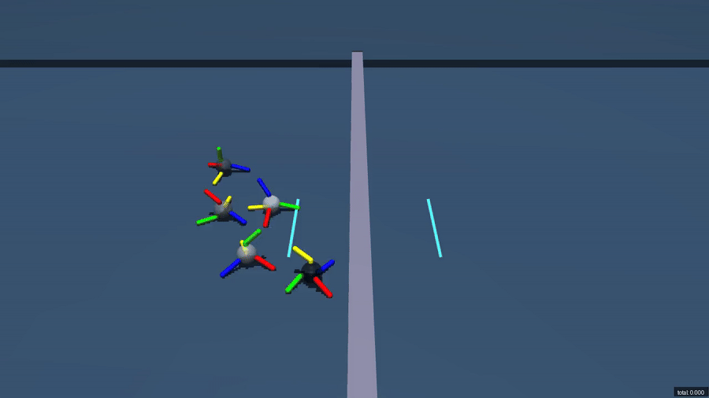

# Scenario catalog

SwarmBots has 18 registered tasks covering coordinated locomotion, physical reconfiguration, partial observability, and payload transport. Eight tasks form the core evaluation suite. Every task uses the same articulated modular units and actuator/connector interface, so policies must control both the units' movement and their connections.

| Wall traversal | Finding an opening |
| --- | --- |
|  |  |

These demonstrations illustrate behavior, not canonical evaluation results.

## Scenario maturity and versioning

SwarmBots as a whole is an **alpha benchmark**. Each registered scenario also has a maturity label describing how thoroughly its task design has been tested:

**All fixed-wall and PO-wall variants (easy, medium, and hard), plus FindOpening, are beta; every other registered scenario is alpha.**

| Maturity | Meaning |
| --- | --- |
| **Alpha** | Limited task-level testing. Difficulty may be too high or too low, reward functions may encourage unintended behavior, and success conditions or other task details may need revision. |
| **Beta** | Extensive internal testing, but no feedback from other researchers yet. Task design may still have gaps and is not considered final. |
| **Stable** | Reserved for a future stage after broader validation and independent research feedback. No scenario currently has this status. |

These labels assess testing confidence, not difficulty, policy performance, or core-suite membership. They apply to the registered defaults; custom variants need their own validation. The overall benchmark remains alpha even when individual scenarios are beta. Feedback channels are [GitHub issues](https://github.com/brn-dev/swarm-bots/issues) and email to Dominik Baron at [dominik.b4ron@gmail.com](mailto:dominik.b4ron@gmail.com); useful reports include the task ID, package version or Git commit, configuration, seed, and observed behavior.

Maturity and version identifiers serve different purposes:

- **Scenario maturity** (`alpha`, `beta`, or eventually `stable`) records the current testing assessment. It is available as `BenchmarkSpec.maturity`, in `swarmbots list` / `describe`, and as `metadata.benchmark_maturity` in evaluation reports.
- **Task version** (the `-v0` suffix in a benchmark ID) identifies the registered task definition. A maturity promotion alone does not change the ID. Changes to rewards, observations, success or termination conditions, morphology distributions, or physics that make scores incomparable should use a new task version.
- **Package version** (such as `0.1.0a3`) identifies the implementation release. Together with the Git commit, it identifies the implementation, including development checkouts; the maturity label and task ID alone do not.
- **Protocol version** (currently `0.1`) identifies the evaluation and reporting procedure, independently of task maturity.

## Registered tasks

| Benchmark ID | Task | Maturity | Core suite | Terminal success metric |
| --- | --- | --- | --- | --- |
| `SwarmBots-WallEasy-v0` | fixed 0.2 m wall | Beta | no | yes |
| `SwarmBots-WallMedium-v0` | fixed 0.3 m wall | Beta | yes | yes |
| `SwarmBots-WallHard-v0` | fixed 0.4 m wall | Beta | no | yes |
| `SwarmBots-WallMixed-v0` | 0.3 m or 0.4 m wall, equally likely per episode | Alpha | no | yes |
| `SwarmBots-POWallEasy-v0` | connected locomotion over a hidden 0.25 m wall | Beta | no | yes |
| `SwarmBots-POWallMedium-v0` | connected locomotion over a hidden 0.3 m wall | Beta | yes | yes |
| `SwarmBots-POWallHard-v0` | connected locomotion over a hidden 0.4 m wall | Beta | no | yes |
| `SwarmBots-FindOpening-v0` | exploration within an episode to find a hidden opening | Beta | yes | yes |
| `SwarmBots-Bridge-v0` | narrow movable bridge traversal | Alpha | yes | yes |
| `SwarmBots-Climb-v0` | platform climbing | Alpha | yes | yes |
| `SwarmBots-VerticalReach-v0` | elevated goal reaching | Alpha | yes | yes |
| `SwarmBots-PayloadPlane-v0` | single-payload transport | Alpha | no | no; report return |
| `SwarmBots-PayloadStep-v0` | payload transport over a step | Alpha | yes | yes |
| `SwarmBots-DualPayloadPlane-v0` | two-payload transport | Alpha | no | no; report return |
| `SwarmBots-PayloadGoal-v0` | single-payload delivery to a sampled goal | Alpha | no | yes |
| `SwarmBots-PayloadGoalSequence-v0` | single-payload delivery through three ordered goals | Alpha | no | yes |
| `SwarmBots-MultiPayloadGoal-v0` | variable payload-to-goal assignment | Alpha | yes | yes |
| `SwarmBots-MoveToGoal-v0` | sampled-goal navigation | Alpha | no | no; report return |

Wall and PO-wall tasks primarily challenge connected locomotion through coordinated movement and physical connections during obstacle traversal. Fixed walls provide three heights: 0.2, 0.3, and 0.4 m. PO-wall adds difficulty through partial observability and randomized hidden geometry, with heights of 0.25, 0.3, and 0.4 m. The hard PO-wall shares the medium variant's observations, rewards, and randomization, with a higher wall.

Wall resets intentionally include partially solved assemblies: some units may already be beyond the wall after settling. This provides an implicit curriculum within the fixed reset distribution. Already-crossed climb and pass milestones are latched at reset and do not earn retroactive rewards; success still requires every active unit to reach the finish threshold.

In `SwarmBots-WallMixed-v0`, each world draws its wall height at episode reset and uses it for collision geometry, height-dependent rewards, and the actor's height observation throughout the episode. To evaluate the same policy at each height, run WallMixed twice with `scenario_kwargs={"wall_height_options": [0.3]}` and `scenario_kwargs={"wall_height_options": [0.4]}`. Each evaluation uses the same one-scalar observation layout as mixed training.

FindOpening focuses on partial observability and exploration within an episode. The task combines discovery of a hidden passage using observations gathered during that episode with coordinated swarm traversal through it.

Bridge adds a narrow movable support. Climb requires all active units to reach a platform goal; VerticalReach succeeds when at least one unit reaches the elevated goal volume. Payload tasks extend coordination to external objects, including multiple payloads with individual goals.

`swarmbots.CORE_BENCHMARK_IDS` and `swarmbots.ALL_BENCHMARK_IDS` expose the core and full suites. The [benchmark protocol](benchmark_protocol.md) defines comparable evaluation. Reward scales differ, so meaningful return comparisons are per task.

## Robot and assembly

The default unit has four articulated limbs, eight hinges, and four connectors. Continuous actuator actions control its movement; connector actions request connections or disconnections. Connections carry physical loads, so changing the connection graph changes the swarm's mechanics during an episode.

Connectors sit on the outer surfaces of the rounded limb caps. Initial assembly spacing follows the connector distance.

All registered scenarios use five padded agent slots, while reset pools may activate four or five units. Inactive slots are identified by `agent_mask`. Initial assemblies are sampled from the shared [morphology population](benchmark_protocol.md#morphology-population); the canonical evaluation does not use unseen morphologies.

Initial assemblies start with their lowest surface 1 mm above the floor and settle under physics before the episode begins. Settling does not consume control steps or contribute to episode return.

Scenario constructors accept keyword overrides through `make_scenario(..., **scenario_kwargs)` or `make_env(..., scenario_kwargs={...})`. The [customization example](#scenario-customization) illustrates a modified task.

## Observation contract

`local_obs` contains proprioception, connection state, and optional connector positions for every agent. `global_obs` contains shared task features that the actor is allowed to observe. `agent_mask` distinguishes active units from padding.

`hidden_local_vars` and `hidden_global_vars` are explicitly privileged. They support centralized critics, auxiliary losses, and diagnostics, but using them as actor inputs invalidates a benchmark result. The official evaluator removes both keys before invoking a policy.

`hidden_global_vars[..., 0]` is the unnormalized active-agent count, equal to the sum of `agent_mask`. Scenario-specific privileged global fields follow from index 1.

For the default four-limb, eight-hinge robot, each agent's `local_obs` has 71 float32 features, concatenated in this order (Python slice notation):

| Slice | Meaning |
| --- | --- |
| `0:3` | Root position `(x, y, z)` in world coordinates, metres |
| `3:9` | Root orientation: first two rotation-matrix columns, each in `(x, y, z)` order |
| `9:25` | Eight hinge angles as interleaved `(sin(angle), cos(angle))` pairs |
| `25:39` | MuJoCo generalized velocity order: root linear velocity (m/s), root angular velocity (rad/s), then hinge velocities (rad/s) |
| `39:59` | Four connector records: `(disconnected, connected, sin(twist), cos(twist), disconnect_potential)` |
| `59:71` | Four connector positions in world coordinates, metres, flattened `(x, y, z)` |

Twist sine/cosine are zero when no valid connection exists. Disconnect potential is an accumulated control quantity, not a physical measurement. `agent_mask` identifies inactive slots; custom joint/observation settings change these offsets. Actions use the same hinge and connector ordering as their observation records.

Shared task features in `global_obs` are positions in world coordinates unless stated otherwise:

| Task | Shared features |
| --- | --- |
| WallEasy, WallMedium, WallHard, PO Wall, Bridge | Empty; privileged obstacle information is not actor input |
| WallMixed | Wall height above ground, in metres |
| FindOpening | Empty; privileged opening information is not actor input |
| Climb, VerticalReach | Goal position `(x, y, z)` |
| MoveToGoal | Goal position `(x, y)` |
| PayloadPlane, PayloadStep | Payload position `(x, y, z)`, followed by its six-dimensional orientation |
| DualPayloadPlane | Two consecutive payload position/orientation records |
| PayloadGoal, MultiPayloadGoal | One 12-feature record per payload slot: active flag, position (3), orientation (6), goal `(x, y)`; PayloadGoal has exactly one active slot |
| PayloadGoalSequence | Payload/current-goal record (12), full route coordinates (6), active-goal one-hot (3), and hold completion fraction (1): 22 features by default |

PayloadGoalSequence optionally appends these features in the order shown. All options default to `False`; enabling all gives 27 public features.

| Option | Appended features |
| --- | --- |
| `include_goal_delta_obs` | World-frame XY displacement `current_goal_xy - payload_xy` (2) |
| `include_payload_velocity_obs` | Payload world-frame linear XY velocity in m/s (2) |
| `include_goal_inside_obs` | Binary inside-current-goal flag (1) |

Vectors participate in normalization and NOP; the inside flag and stage one-hot remain raw.

Inactive MultiPayloadGoal records have zero positions/goals and identity orientation. These payload masks are separate from `agent_mask`. `env.single_observation_space` and `env.single_action_space` describe the selected task; the corresponding spaces without `single_` include the world dimension.

## Success and termination

Success is a team-level boolean. Padding never counts toward success. For success-enabled tasks, `info["success"]` refers to the episode that just stepped, including its terminal step. In `NEXT_STEP` autoreset, reset-only entries have zero reward and false success; they are excluded from episode statistics and learning transitions.

| Task | Success condition |
| --- | --- |
| Wall and PO Wall | Every active unit has `y > wall_y + wall_success_threshold` |
| FindOpening | Every active unit has `y > wall_y + opening_y_margin` |
| Bridge | Every active unit has `y > success_y` and its root at or above the destination platform top (`z >= 0`), with no active unit below `fall_z_threshold` |
| Climb | Every active unit's root lies within `goal_radius` of the 3D goal |
| VerticalReach | At least one active unit's root lies inside the goal box |
| PayloadStep | Payload centre reaches `payload_success_y` and the required height while remaining over the step's finite width and length |
| PayloadGoal | The single payload centre lies within `goal_radius` of its 3D goal (goal height is the payload radius) |
| PayloadGoalSequence | The payload completes all three goals in order, staying within each goal's 0.15 m 3D centre tolerance for at least 0.5 s of consecutive observed control intervals |
| MultiPayloadGoal | Every active payload centre lies within `goal_radius` of its assigned 3D goal (goal height is the payload radius) |

PayloadPlane, DualPayloadPlane, and MoveToGoal have no success metric; their scores are episode returns. Episodes truncate at 500 control steps by default, or 1,000 for PayloadGoalSequence. Success terminates an episode for the success-enabled tasks; bridge falls and nonfinite simulator state can also terminate unsuccessfully. The default control period is `0.003 * 10 = 0.03` seconds. Reward terms are exposed in `info["reward_terms"]`; weights and thresholds are in `env.get_settings()` and exported evaluation metadata.

For wall tasks with a forward boost, approaching the wall earns extra forward progress as the unit clears the top. The boost ramps in over one body radius of height. Crossing the far face retains the accumulated progress as the unit descends. Reset and step rewards use the same potential and the wall height for that episode.

Rewards measure task progress and task-specific outcomes. Connection topology contributes no direct reward or penalty; connections affect the swarm's physical behavior. Historical reward and physics changes are recorded in the [changelog](../CHANGELOG.md) and can make scores from different revisions incomparable.

## Payload delivery tasks

### PayloadGoal

PayloadGoal delivers one box payload to a goal sampled before physics settling and held fixed for the episode. Its default goal distribution is a 3 m arc spanning 120° around world +Y, with independent, unbounded Gaussian XY noise of standard deviation 0.15 m. Settling can shift the payload relative to this arc. The payload starts one metre ahead of the swarm, with a shared XY translation sampled within ±0.25 m; success uses a 0.35 m goal radius.

`goal_arc_radius`, `goal_arc_degrees`, and `goal_noise_std` configure the distribution. Approach shaping encourages the swarm to gather near a pushing reference point behind the payload; the [approach options](#approach-reward-options) apply to both single-payload delivery tasks.

### PayloadGoalSequence

PayloadGoalSequence requires three ordered deliveries within 1,000 control steps (30 s). The full route is sampled at reset, rotated with the starting assembly by a uniformly sampled yaw, and held fixed through settling and the episode.

| Leg | Uniform distance | Uniform turn relative to the preceding direction |
| --- | --- | --- |
| First | 0.9–1.1 m | ±5° from the starting forward direction |
| Second | 1–2 m | ±45° |
| Third | 1–2 m | ±90° |

`goal_distance_ranges` and `goal_turn_arc_degrees` configure matched sequences of distances and turns; custom routes require each minimum leg length to exceed twice `goal_radius`.

A goal completes after the payload centre remains within 0.15 m of `(goal_x, goal_y, payload_radius)` for `goal_hold_time=0.5` s. At the default 30 ms control period this requires 18 consecutive inside observations spanning 0.51 s. The public hold fraction counts those observations divided by 18, rather than literal elapsed time. Leaving resets the hold; reaching later goals early has no effect. Intermediate completion changes the target without resetting the scene; only the final goal terminates successfully.

Forward and approach shaping follow the current goal, with default weights 10 and 1. Intermediate goals have `waypoint_reward=2` and final completion has `success_reward=5`. Target changes do not introduce shaping-reward jumps. On final completion, goal coordinates retain the final point, the stage one-hot becomes zero, and hold fraction is 1. The optional inside-goal flag describes the target currently shown in the observation; it does not indicate completed holding.

Partial progress is available as `info["goals_completed"]` and `goal_<n>_reached`; `current_goal_index` is zero-based, with `num_goals` indicating completion. Included learners log episode means as `ep_task_goals_completed` and `ep_task_goal_<n>_reached`, including timeouts. Frozen evaluation adds `eval_stochastic_` or `eval_deterministic_` prefixes and aggregates only episodes that report each metric.

`goal_hold_reward_fraction` optionally distributes a fraction `f` of each completion bonus `B` across its hold (default `0`). The hold reward is `f * B * (h_next - h_previous)`, where `h` counts confirmed hold intervals; completion pays `(1 - f) * B`. Both are scaled by `progress_reward_weight`. First entry earns no hold credit, leaving reverses accumulated credit, and a timeout can retain partial credit without counting as a reached goal. This changes reward timing and discounted returns, so report the fraction in comparisons.

### Approach reward options

The pushing reference point lies one payload radius behind the payload relative to its current goal: `payload_xy - payload_radius * unit(goal_xy - payload_xy)`. The default zone potential is the negative mean distance of active roots beyond a 1.25 m radius around this point. It encourages proximity with a rearward bias, without enforcing a strict pushing direction.

The optional `towards_payload_potential="pseudo_huber"` uses `-mean(sqrt(d_i**2 + s**2) - s)` over all active roots, where `d_i` is horizontal distance to the reference point and `s` is `towards_payload_softness` (default 0.5 m). It is approximately linear far away and quadratic nearby, with no flat zone. `towards_payload_goal_radius` applies only to the default `"zone"` mode.

Both modes reward weighted potential differences using `progress_reward_weight`, `towards_payload_reward_weight` (default 1), and `potential_reward_discount_factor`. Stationary geometry earns zero when the potential discount is 1. Set `towards_payload_reward_weight=0.0` for an approach-shaping ablation. Overrides are supplied through `scenario_kwargs` and recorded in resolved settings.

### Multiple payloads and placement

MultiPayloadGoal retains its rectangular goal distribution without the approach term. It samples assignments that allow all active payloads to occupy their goals without overlap in their reset orientation. `goal_rect` bounds payload centres; custom rectangles must accommodate the maximum active count.

Payload reset spacing accounts for shape and radius. `payload_spawn_margin` requests minimum centre spacing; the resolved `payload_spawn_spacing` may be larger to avoid overlap. DualPayloadPlane expands default X offsets for larger shapes, while explicit `payload_offset_x` placements must provide their own clearance.

PayloadStep climb shaping applies within the platform width; its climb milestone requires the payload centre to be over the finite platform at the required height.

## Action contract

`actuators` are continuous values in `[-1, 1]`. `connectors` are continuous by default: any positive value requests a connection immediately when an eligible partner is nearby. Negative values accumulate disconnection intent according to their magnitude; positive values reduce accumulated disconnection intent, and zero holds it unchanged. Scenarios can still be constructed with `continuous_connector_actions=False` for ablations, but those results are not directly comparable to the registered defaults.

## Scenario customization

Scenario overrides create custom variants of a registered task:

```python
from swarmbots import make_env

env = make_env(
    "SwarmBots-POWallMedium-v0",
    num_envs=128,
    device="cuda",
    scenario_kwargs={
        "wall_height": 0.35,
        "continuous_connector_actions": False,
    },
)
env.close()
```

A result with overrides describes a custom variant of the base task. Reporting includes every override and distinguishes it from the canonical registered configuration.

Custom geometry and reset settings are validated during construction. Climb, PayloadGoal, PayloadGoalSequence and MultiPayloadGoal require finite `goal_radius >= 1e-6` metres; reset settling requires finite `reset_settle_timestep_scale > 0`. Invalid sampling distributions or goal regions raise errors rather than producing a valid canonical task.
