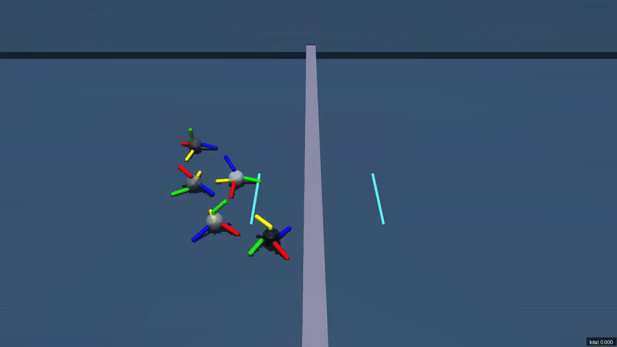
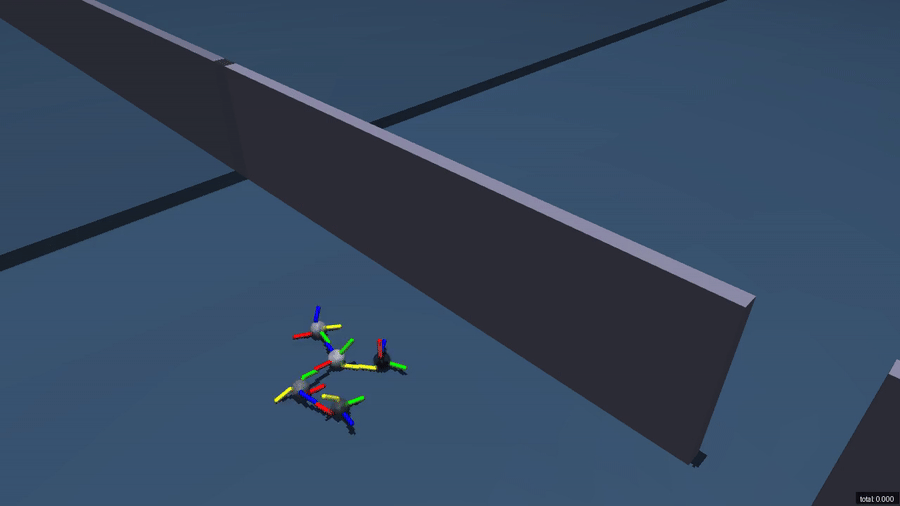

# Scenario catalog

SwarmBots has 15 registered tasks covering coordinated locomotion, physical reconfiguration, partial observability, and payload transport. Eight tasks form the core evaluation suite. Every task uses the same articulated modular units and actuator/connector interface, so policies must control both the units' movement and their connections.

| Wall traversal | Finding an opening |
| --- | --- |
|  |  |

These demonstrations illustrate behavior, not canonical evaluation results.

## Scenario maturity and versioning

SwarmBots as a whole is an **alpha benchmark**. Each registered scenario also has a maturity label describing how thoroughly its task design has been tested:

**All fixed-wall and PO-wall variants (easy, medium, and hard), plus FindOpening, are beta; every other registered scenario is alpha.**

| Maturity | Meaning |
| --- | --- |
| **Alpha** | Limited task-level testing. Difficulty may be too high or too low, reward functions may encourage unintended behavior, and success conditions or other task details may need revision. |
| **Beta** | Extensive internal testing, but no feedback from other researchers yet. Task design may still have gaps and is not considered final. |
| **Stable** | Reserved for a future stage after broader validation and independent research feedback. No scenario currently has this status. |

These labels assess testing confidence, not difficulty, policy performance, or core-suite membership. They apply to the registered defaults; custom variants need their own validation. The overall benchmark remains alpha even when individual scenarios are beta. Feedback channels are [GitHub issues](https://github.com/brn-dev/swarm-bots/issues) and email to Dominik Baron at [dominik.b4ron@gmail.com](mailto:dominik.b4ron@gmail.com); useful reports include the task ID, package version or Git commit, configuration, seed, and observed behavior.

Maturity and version identifiers serve different purposes:

- **Scenario maturity** (`alpha`, `beta`, or eventually `stable`) records the current testing assessment. It is available as `BenchmarkSpec.maturity`, in `swarmbots list` / `describe`, and as `metadata.benchmark_maturity` in evaluation reports.
- **Task version** (the `-v0` suffix in a benchmark ID) identifies the registered task definition. A maturity promotion alone does not change the ID. Changes to rewards, observations, success or termination conditions, morphology distributions, or physics that make scores incomparable should use a new task version.
- **Package version** (such as `0.1.0a3`) identifies the implementation release. Together with the Git commit, it identifies the implementation, including development checkouts; the maturity label and task ID alone do not.
- **Protocol version** (currently `0.1`) identifies the evaluation and reporting procedure, independently of task maturity.

## Registered tasks

| Benchmark ID | Task | Maturity | Core suite | Terminal success metric |
| --- | --- | --- | --- | --- |
| `SwarmBots-WallEasy-v0` | fixed 0.2 m wall | Beta | no | yes |
| `SwarmBots-WallMedium-v0` | fixed 0.3 m wall | Beta | yes | yes |
| `SwarmBots-WallHard-v0` | fixed 0.4 m wall | Beta | no | yes |
| `SwarmBots-POWallEasy-v0` | connected locomotion over a hidden 0.25 m wall | Beta | no | yes |
| `SwarmBots-POWallMedium-v0` | connected locomotion over a hidden 0.3 m wall | Beta | yes | yes |
| `SwarmBots-POWallHard-v0` | connected locomotion over a hidden 0.4 m wall | Beta | no | yes |
| `SwarmBots-FindOpening-v0` | exploration within an episode to find a hidden opening | Beta | yes | yes |
| `SwarmBots-Bridge-v0` | narrow movable bridge traversal | Alpha | yes | yes |
| `SwarmBots-Climb-v0` | platform climbing | Alpha | yes | yes |
| `SwarmBots-VerticalReach-v0` | elevated goal reaching | Alpha | yes | yes |
| `SwarmBots-PayloadPlane-v0` | single-payload transport | Alpha | no | no; report return |
| `SwarmBots-PayloadStep-v0` | payload transport over a step | Alpha | yes | yes |
| `SwarmBots-DualPayloadPlane-v0` | two-payload transport | Alpha | no | no; report return |
| `SwarmBots-MultiPayloadGoal-v0` | variable payload-to-goal assignment | Alpha | yes | yes |
| `SwarmBots-MoveToGoal-v0` | sampled-goal navigation | Alpha | no | no; report return |

Wall and PO-wall tasks primarily challenge connected locomotion through coordinated movement and physical connections during obstacle traversal. Fixed walls provide three heights: 0.2, 0.3, and 0.4 m. PO-wall adds difficulty through partial observability and randomized hidden geometry, with heights of 0.25, 0.3, and 0.4 m. The hard PO-wall shares the medium variant's observations, rewards, and randomization, with a higher wall.

Wall resets intentionally include partially solved assemblies: some units may already be beyond the wall after settling. This provides an implicit curriculum within the fixed reset distribution. Already-crossed climb and pass milestones are latched at reset and do not earn retroactive rewards; success still requires every active unit to reach the finish threshold.

FindOpening focuses on partial observability and exploration within an episode. The task combines discovery of a hidden passage using observations gathered during that episode with coordinated swarm traversal through it.

Bridge adds a narrow movable support. Climb requires all active units to reach a platform goal; VerticalReach succeeds when at least one unit reaches the elevated goal volume. Payload tasks extend coordination to external objects, including multiple payloads with individual goals.

`swarmbots.CORE_BENCHMARK_IDS` and `swarmbots.ALL_BENCHMARK_IDS` expose the core and full suites. The [benchmark protocol](benchmark_protocol.md) defines comparable evaluation. Reward scales differ, so meaningful return comparisons are per task.

## Robot and assembly

The default unit has four articulated limbs, eight hinges, and four connectors. Continuous actuator actions control its movement; connector actions request connections or disconnections. Connections carry physical loads, so changing the connection graph changes the swarm's mechanics during an episode.

Connectors sit on the outer surfaces of the rounded limb caps. Initial assembly spacing follows the connector distance.

All registered scenarios use five padded agent slots, while reset pools may activate four or five units. Inactive slots are identified by `agent_mask`. Initial assemblies are sampled from the shared [morphology population](benchmark_protocol.md#morphology-population); the canonical evaluation does not use unseen morphologies.

Initial assemblies start with their lowest surface 1 mm above the floor and settle under physics before the episode begins. Settling does not consume control steps or contribute to episode return.

Scenario constructors accept keyword overrides through `make_scenario(..., **scenario_kwargs)` or `make_env(..., scenario_kwargs={...})`. The [customization example](#scenario-customization) illustrates a modified task.

## Observation contract

`local_obs` contains proprioception, connection state, and optional connector positions for every agent. `global_obs` contains shared task features that the actor is allowed to observe. `agent_mask` distinguishes active units from padding.

`hidden_local_vars` and `hidden_global_vars` are explicitly privileged. They support centralized critics, auxiliary losses, and diagnostics, but using them as actor inputs invalidates a benchmark result. The official evaluator removes both keys before invoking a policy.

For every scenario, `hidden_global_vars[..., 0]` is the raw active-agent count, equal to the sum of `agent_mask` over agent slots. The environment prepends this float32 value; scenario-specific hidden global fields follow from index 1. Learning wrappers leave the count unnormalized. It remains valid in terminal observations, including simulation failures.

For the default four-limb, eight-hinge robot, each agent's `local_obs` has 71 float32 features, concatenated in this order (Python slice notation):

| Slice | Meaning |
| --- | --- |
| `0:3` | Root position `(x, y, z)` in world coordinates, metres |
| `3:9` | Root orientation: first two rotation-matrix columns, each in `(x, y, z)` order |
| `9:25` | Eight hinge angles as interleaved `(sin(angle), cos(angle))` pairs |
| `25:39` | MuJoCo generalized velocity order: root linear velocity (m/s), root angular velocity (rad/s), then hinge velocities (rad/s) |
| `39:59` | Four connector records: `(disconnected, connected, sin(twist), cos(twist), disconnect_potential)` |
| `59:71` | Four connector positions in world coordinates, metres, flattened `(x, y, z)` |

Twist sine/cosine are zero when no valid connection exists. Disconnect potential is an accumulated control quantity, not a physical measurement. `agent_mask` identifies inactive slots; custom joint/observation settings change these offsets. Actions use the same hinge and connector ordering as their observation records.

Shared task features in `global_obs` are positions in world coordinates unless stated otherwise:

| Task | Shared features |
| --- | --- |
| Wall, PO Wall, Bridge | Empty; privileged obstacle information is not actor input |
| FindOpening | Empty; privileged opening information is not actor input |
| Climb, VerticalReach | Goal position `(x, y, z)` |
| MoveToGoal | Goal position `(x, y)` |
| PayloadPlane, PayloadStep | Payload position `(x, y, z)`, followed by its six-dimensional orientation |
| DualPayloadPlane | Two consecutive payload position/orientation records |
| MultiPayloadGoal | One 12-feature record per payload slot: active flag, position (3), orientation (6), goal `(x, y)` |

Inactive MultiPayloadGoal records have zero positions/goals and identity orientation. These payload masks are separate from `agent_mask`. `env.single_observation_space` and `env.single_action_space` describe the selected task; the corresponding spaces without `single_` include the world dimension.

## Success and termination

Success is a team-level boolean. Padding never counts toward success. For success-enabled tasks, `info["success"]` refers to the episode that just stepped, including its terminal step. In `NEXT_STEP` autoreset, reset-only entries have zero reward and false success; they are excluded from episode statistics and learning transitions.

| Task | Success condition |
| --- | --- |
| Wall and PO Wall | Every active unit has `y > wall_y + wall_success_threshold` |
| FindOpening | Every active unit has `y > wall_y + opening_y_margin` |
| Bridge | Every active unit has `y > success_y` and its root at or above the destination platform top (`z >= 0`), with no active unit below `fall_z_threshold` |
| Climb | Every active unit's root lies within `goal_radius` of the 3D goal |
| VerticalReach | At least one active unit's root lies inside the goal box |
| PayloadStep | Payload centre reaches `payload_success_y` and the required height while remaining over the step's finite width and length |
| MultiPayloadGoal | Every active payload centre lies within `goal_radius` of its assigned 3D goal (goal height is the payload radius) |

PayloadPlane, DualPayloadPlane, and MoveToGoal have no success metric; their scores are episode returns. Episodes truncate at 500 control steps by default. Success terminates an episode for the success-enabled tasks; bridge falls and nonfinite simulator state can also terminate unsuccessfully. The default control period is `0.003 * 10 = 0.03` seconds. Reward terms are exposed in `info["reward_terms"]`; weights and thresholds are in `env.get_settings()` and exported evaluation metadata.

Rewards measure task progress and task-specific outcomes. Connection topology contributes no direct reward or penalty; connections affect the swarm's physical behavior. Historical reward and physics changes are recorded in the [changelog](../CHANGELOG.md) and can make scores from different revisions incomparable.

MultiPayloadGoal samples assignments that allow all active payloads to occupy their goals without overlap in their reset orientation. The goal rectangle bounds payload centres, not their full shapes. Custom rectangles must accommodate the maximum possible active count; invalid configurations fail during construction.

Payload reset spacing accounts for shape and radius. `payload_spawn_margin` is the requested minimum centre spacing; the resolved `payload_spawn_spacing` may be larger to avoid overlap. Both values are recorded in settings.

DualPayloadPlane expands its default X offsets when the payload shape or radius needs more separation. Explicit `payload_offset_x` overrides are used as supplied; custom placements must provide their own collision clearance.

PayloadStep height shaping applies within the platform's width. Its climb milestone requires the payload centre to be over the finite platform and at the required height. Crossing the front line beside the platform or below that height does not retain a climb bonus.

## Action contract

`actuators` are continuous values in `[-1, 1]`. `connectors` are continuous by default: any positive value requests a connection immediately when an eligible partner is nearby. Negative values accumulate disconnection intent according to their magnitude; positive values reduce accumulated disconnection intent, and zero holds it unchanged. Scenarios can still be constructed with `continuous_connector_actions=False` for ablations, but those results are not directly comparable to the registered defaults.

## Scenario customization

Scenario overrides create custom variants of a registered task:

```python
from swarmbots import make_env

env = make_env(
    "SwarmBots-POWallMedium-v0",
    num_envs=128,
    device="cuda",
    scenario_kwargs={
        "wall_height": 0.35,
        "continuous_connector_actions": False,
    },
)
env.close()
```

A result with overrides describes a custom variant of the base task. Reporting includes every override and distinguishes it from the canonical registered configuration.

Custom geometry and reset settings are validated during construction. Climb and MultiPayloadGoal require finite `goal_radius >= 1e-6` metres; reset settling requires finite `reset_settle_timestep_scale > 0`. Invalid sampling distributions or goal regions raise errors rather than producing a valid canonical task.
